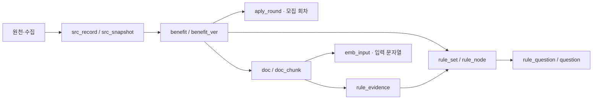

# Bene_Fit

내 삶에 딱 맞는 혜택. AI 기반 개인 맞춤형 생활 혜택 플랫폼.

전국 공통 주거·복지 제도부터 시작하고, 이후 지역별 혜택으로 확장합니다. 초기 사용성 검증은 대전 지인 중심으로 진행합니다.

현재는 로컬 개발용 프로토타입입니다. 공공데이터를 PostgreSQL 17로 이전하고 웹 목록·상세 조회를 연결했습니다. 선택형 가족 탐색과 원문 근거를 제공하며 개인정보는 선택 시 브라우저에 암호화 저장합니다. 데스크탑에서 새 모델을 선택하기 위해 임베딩을 중단·삭제한 상태로, 현재 검색은 키워드 방식입니다. 자동 자격 판정과 생성형 답변은 아직 구현하지 않았습니다.

## 설계 문서

- **[데스크탑 인수인계 · 현재 상태와 실행 순서](docs/DESKTOP_HANDOFF.md)**
- [현재 설계 및 MVP 요구사항](docs/DESIGN.md)
- [공식 데이터 소스 조사와 검증 계획](docs/DATA_SOURCES.md)
- [RAG 및 기술 후보](docs/ARCHITECTURE.md)
- [PostgreSQL DB 설계·ERD·이전 계획](docs/DATABASE.md)
- **[DB 구성도 · 실제 테이블·PK·FK ERD](docs/DB_ERD.md)**
- [오로르 기준 코드·DB 컨벤션](docs/CONVENTIONS.md)
- [PostgreSQL 실행·적재·백업·데스크탑 복원](docs/POSTGRES_OPERATIONS.md)
- [주요 결정](docs/DECISIONS.md)
- [진행 계획](docs/ROADMAP.md)
- [인수인계](docs/HANDOFF.md)

공식 근거를 바탕으로 혜택을 탐색하고 조건을 비교하는 서비스입니다. 최종 자격 결정은 해당 기관의 심사에 따릅니다.

## DB 구성도



현재 PostgreSQL 기본 테이블은 20개입니다. [전체 PK·FK 구성도](docs/DB_ERD.md)에서 확인할 수 있습니다. 벡터 테이블은 모델 선택 후 별도로 적용합니다.

## API 연결 확인

로컬 인증키 입력과 실행 방법: [API 연결 확인](docs/API_CHECK.md). 7개 API 실호출과 목록 수집을 확인했습니다. [수집 검증 결과](docs/COLLECTION_RESULTS.md)를 참고하세요.

## 로컬 검색 목록

[정규화 데이터 및 검색 사용법](docs/CATALOG.md): 전체 16,196건, 중앙부처 검토 후보 1,509건. 전국 적용 여부는 미검증입니다.

## 브라우저에서 검색

`.venv-embedding\Scripts\python.exe scripts/serve_catalog.py` 실행 후 http://127.0.0.1:8765 접속. [로컬 화면 안내](docs/LOCAL_WEB.md). 임베딩 진행률은 `/progress`에서 확인합니다.

## 마이페이지·맞춤 후보

/my에서 상세 프로필을 암호화 저장하고 /recommended에서 관련 혜택을 탐색합니다. [개인정보 보관 및 추천 범위](docs/PROFILE.md).

## 선택형 가족 탐색 후속 (2026-11-27)

저장 없이 가족·목적 선택 후 필요한 질문만 받는 흐름으로 교체했다. 개인정보 질문은 모두 건너뛸 수 있고 저장을 원할 때만 암호화한다. 자격 규칙 연결은 아직 전이며 결과는 확인 필요로 표시한다. [실행·설계 상세](docs/GUIDED_SEARCH.md).

## 원본·검색 조각·조건 저장 (2026-11-27)

원천 스냅샷과 내용 버전을 보관하고 88,458개 검색 조각, 101,080개 미승인 조건 초안을 별도 SQLite 테이블로 생성했다. 원문 위치·앞뒤 조각·관계 표현을 연결했다. 설명 조각 77,560개의 벡터 생성과 웹 검색을 연결했으며, 전체 생성·품질 검증은 진행 중이다. 생성형 답변과 자격 필터는 아직 미구현이다. [파이프라인 안내](docs/KNOWLEDGE_PIPELINE.md), [임베딩 검색·갱신](docs/EMBEDDING_SEARCH.md).

## 이전 시험 임베딩 모델

BGE-M3 (BAAI/bge-m3), 1,024차원으로 시험했다. 기존 설정은 config/embedding.json에 남아 있으며 새 운영 모델은 데스크탑에서 선택한다. 현재 임베딩은 중단했고 생성 벡터는 삭제했다. API 키 .env는 일반 텍스트이며 개인정보 프로필의 브라우저 암호화와 별개다.

## 수집 이후 검색 데이터 갱신

아래는 PostgreSQL 전환 전의 SQLite 기반 처리 명령입니다. 현재 웹 DB를 갱신하는 명령이 아니며, 새 모델 선택 전에는 전체 임베딩을 재시작하지 않습니다. 최초 PG 적재·검증과 실행은 POSTGRES_OPERATIONS.md를 따릅니다. PG 증분 적재는 후속 작업입니다.

```powershell
.venv-embedding\Scripts\python.exe scripts/refresh_search.py --plan
.venv-embedding\Scripts\python.exe scripts/refresh_search.py
```

현재 전체 생성이 실행 중이면 갱신을 차단합니다. 이 명령은 API를 새로 호출하거나 정기 수집을 예약하지 않습니다.
