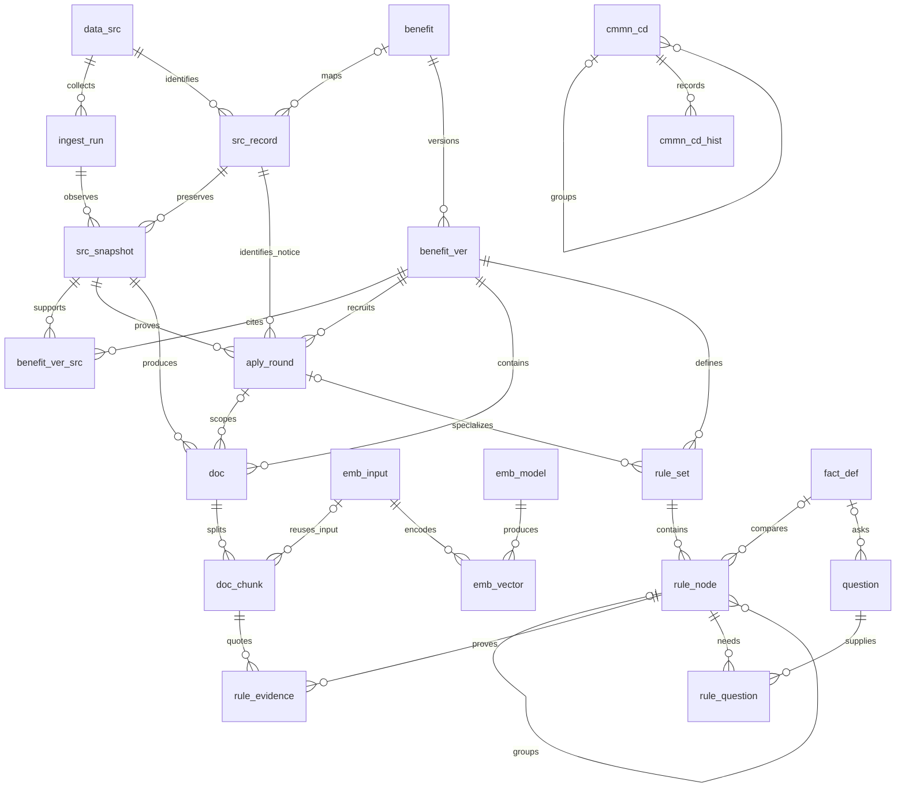

# PostgreSQL DB 설계 v2 · 약칭 적용

기준일: 2026-11-27. **PostgreSQL 사용은 사용자 확정**이다. 약칭 스키마를 PostgreSQL 17.12에 적용하고 기존 SQLite 데이터를 적재·대조 검증했으며 웹 읽기 경로도 전환했다. 개인정보는 현재 합의대로 브라우저 암호화 보관을 유지한다. 벡터 생성은 집 데스크탑에서 모델을 결정한 뒤 진행한다.

## 명명 규칙

오로르의 실제 DB 문서와 Prisma 스키마를 기준으로 [CONVENTIONS.md](CONVENTIONS.md)를 적용한다. 테이블은 의미가 드러나는 단수 snake_case, 컬럼은 nm/cd/cont/stat/rgst/upt/del/prnt 등 관례적인 약어를 사용한다. 참거짓은 *_yn, 일시는 *_dttm, 기준일은 *_dt다. SQL 테이블·컬럼만 변경했으며 API JSON 키와 기존 원문 키는 보존한다.

## 설계의 기준

- 제도 식별자, 제도 내용 버전, 모집 회차, 원문, 추출 조건을 구분한다.
- 원문·가공 문서·승인 규칙은 내용 수정 대신 새 버전을 추가한다. 수집 시각은 내용 변경으로 취급하지 않는다.
- 출처가 다른 같은 이름의 제도는 자동 병합하지 않는다. 초기에는 원천별로 program을 만들고 매핑 검토 전에는 같은 제도로 간주하지 않는다.
- 개인 조건은 선택 입력이다. 나이·지역·소득·자산을 필수 컬럼으로 둔 사용자 프로필 테이블은 만들지 않는다.
- 미응답, 자료 부족, 규칙 미검토, 기간 미확인을 자격 미충족으로 바꾸지 않는다.
- 구조·관계·검증에 쓰는 값은 컬럼/FK로, 원천별 필드와 미검토 추출 결과는 JSONB로 보관한다.

## 전체 관계

실제 PostgreSQL의 PK·FK와 주요 컬럼을 표시한 [별도 DB 구성도](DB_ERD.md)도 제공한다.



`emb_vector`는 선택 확장인 pgvector 적용 시 만드는 테이블이다. 코어 18개와 공통코드/이력 2개는 확장 없이 생성한다. 기존 ID·관계를 보존하기 위해 UUID·text 타입을 유지하며 공통코드에는 BIGINT identity를 쓴다.

## 테이블 명세

모든 컬럼·타입·제약의 기준은 [001_core.sql](../database/001_core.sql)이다.

공통코드·감사·소프트 삭제는 005_aurore_lifecycle.sql, 제약/인덱스 접두사는 006_object_names.sql을 함께 적용한다. 실제 사용 테이블은 20개이며 cmmn_cd의 그룹/항목 61개와 cmmn_cd_hist의 변경 이력을 포함한다.

| 테이블 | 저장 내용·주요 키 | 변경 방식 |
|---|---|---|
| data_src | 원천 코드, 명칭, 홈페이지 | 제공 기관 설정 수정 |
| ingest_run | 원천·데이터셋·수집 시작/종료·완료/부분/실패·건수 | 한 수집 실행의 상태 갱신 |
| benefit | 원천 정보와 별개인 제도 내부 ID | 안정적인 식별자 |
| src_record | 원천 코드+외부 ID+program/notice 종류, program 매핑, 최초/최근 확인 | 관찰·매핑 상태 갱신 |
| src_snapshot | 원천 레코드, 수집 실행, 내용 해시, JSONB, 선택적 원문 텍스트, 원천 수정/수집 시각 | 추가만 허용 |
| benefit_ver | 제도별 내용 해시, 명칭·기관·분야·요약, 원천별 fld_json/codes, 적용 기간·지역 및 검증 상태 | 새 버전 추가, current_yn만 전환 |
| benefit_ver_src | 제도 버전과 원문 스냅샷의 N:M 연결, 항목별 출처 매핑 | 해당 버전의 근거 연결 |
| aply_round | 실제 공고의 원천 ID·회차 키·정정 rev_no, 공고/접수 시각, 기간 확인 상태 | 정정 시 새 rev_no, 현재 표시만 전환 |
| doc | 제도 버전·선택적 회차·원문, 파서 버전, 가공 필드, 기존 문서 ID | 추가만 허용 |
| doc_chunk | 문서·필드·문자 시작/끝·본문·원문 위치·분할 버전·임베딩 입력 해시 | 추가만 허용 |
| emb_input | UTF-8 입력 문자열의 SHA-256과 실제 모델 입력 본문 | 동일 입력 중복 제거, 추가만 허용 |
| fact_def | age_months 등 사실 코드, number/boolean/enum 타입, 단위·의미·비교 지원 여부 | 승인 규칙이 사용하면 변경 금지 |
| question | 버전 포함 질문 ID, 사실 코드, 질문 대상, 문구·설명·선택지 | 모두 선택 입력, 승인 규칙이 사용하면 새 ID로 개정 |
| rule_set | 제도 버전·회차·세부 지원 유형·규칙 rev_no, 초안/승인/퇴역, 적용 기간·검토자·검토 근거 | 초안만 편집, 승인 후 새 rev_no |
| rule_node | 조건 및 AND/OR/NOT 트리, 사실·대상·연산·값, 미검토 원천 payload | 같은 규칙 집합 내 트리, 초안만 편집 |
| rule_evidence | 규칙 노드와 근거 조각, 조각 내 문자 위치·인용문 | 초안만 편집 |
| rule_question | 조건이 필요로 하는 질문, 사실 코드·대상 역할 | 초안만 편집, 대상·사실의 동일성 FK 검사 |
| emb_model | 공급자·모델·고정 rev_no·차원·프롬프트·정규화·출력 설정 해시·활성 여부 | 설정 불변, 활성 여부만 변경 |
| emb_vector | 모델+입력 해시별 벡터·차원·생성 시각 | 새 모델은 별도 데이터, 삭제·재생성 가능 |
| cmmn_cd | 부모 코드·의미형 코드·명칭·설명·그룹/항목·순서·사용 여부 | 변경 시 이력 보관, 업무 삭제는 소프트 삭제 |
| cmmn_cd_hist | 공통코드 변경 요청·행위·변경 전후 JSON | 공통코드 변경 트리거로 기록 |

개인정보, 로그인 토큰, API 키는 위 테이블에 저장하지 않는다. `rvwr_id`는 검토 서비스의 내부 식별자로 사용하고 실제 이름·이메일을 넣지 않는다. 데이터베이스 접속 정보는 실행 환경에서 관리하며 DDL에 비밀번호를 넣지 않는다.

## 버전·회차·기간

예를 들어 같은 양육 지원 제도의 2026년 설명을 바꾸면 benefit_ver를 추가한다. 그 제도가 별도 신청 공고를 내면 aply_round를 추가한다. 공고 정정은 같은 source_record/rnd_key의 revision을 증가시킨다. 모집 회차가 없는 상시 제도를 위해 가짜 회차를 만들지 않는다.

현재 버전은 program당 하나, 현재 공고 정정본은 원천 공고·회차당 하나다. 서로 다른 출처를 같은 program으로 묶는 것은 수동 검토와 별도 매핑/병합 절차가 필요하다. 기관이나 명칭만으로 묶지 않는다. 제도가 확인되지 않은 LH 공고는 원천 레코드·스냅샷에 보존하고, 검토 전 임의의 제도에 연결하지 않는다.

`current_yn`는 최근 수집한 설명이라는 뜻이다. 현재 신청 가능, 올해 적용, 전국 적용을 의미하지 않는다. 기간과 지역은 별도 검증 플래그를 함께 확인한다. 접수 종료 시각은 시각을 포함한 timestamptz, 제도/규칙 적용일은 date로 저장한다. 날짜 종료일은 포함으로 해석하고, 시각 기준은 공식 안내의 정밀도를 보존하며 경계 비교는 검토 후 정한다. 원천이 날짜만 주면 임의의 마감 시각을 확정하지 않는다.

NULL은 미확인이다. 상시 모집은 `period_type_cd=always_open`으로 명시하고 검증 여부를 따로 보관한다. 접수 기간을 모른다고 상시 모집으로 저장하지 않는다. 미확인 기간 때문에 원문 안내를 숨기지는 않되 ‘신청 가능’ 표시는 하지 않는다.

## 조건과 추가 질문

질문 대상은 `applicant` 신청자, `beneficiary` 혜택 대상자, `guardian` 보호자, `household` 제도가 정의한 가구를 구분한다. UI의 나/자녀/부모님은 탐색 대상과의 관계이며 DB 규칙의 역할과 동일한 값이 아니다. 예를 들어 부모가 자녀 혜택을 검색할 때 질문의 beneficiary는 자녀다.

개념 예시(실제 제도 규칙 아님): `beneficiary.age_months <= 36` 조건은 `age_months` 사실 코드·`beneficiary` 역할·`lte` 연산·숫자 36으로 나눈다. 연결 질문도 같은 사실과 대상 역할을 가져야 한다. 질문 ID는 `beneficiary.age_months@1`처럼 버전을 포함해 새 의미의 질문으로 개정할 때 과거 질문을 덮어쓰지 않는다. 기존 web/guided.js의 flat key와 이 질문 카탈로그 사이 어댑터는 후속 구현이다.

여러 조건은 all/any/not 트리로 표현한다. `between` 같은 경계가 모호한 연산 대신 하한·상한과 포함 여부를 각각 gt/gte/lt/lte 노드로 둔다. AND/OR·예외 관계가 확인되지 않은 기존 초안 그룹은 unresolved로 옮긴다. 키워드나 Y 코드만으로 AND/OR를 추정하지 않는다.

[003_rule_review.sql](../database/003_rule_review.sql)은 승인을 시도할 때 다음을 확인한다.

- 하나의 연결된 트리이고 순환·미확정 관계가 없는지
- 조건의 대상·타입·비교 지원·연산·값·연결 질문이 있는지
- 모든 조건과 논리 관계에 근거가 있는지
- 같은 제도 버전/회차의 근거이며 인용문이 저장된 조각과 글자 단위로 일치하는지
- 적용일·기준 설명·검토 식별자·검토 시각·검토 메모가 있는지

이 검사는 규칙 구조의 유효성을 확인한다. 공식 문서의 의미를 올바르게 해석했는지, 누락 예외가 없는지는 검토자가 확인해야 한다. 승인 권한은 향후 인증 API가 통제하고, 일반 서비스 계정에 테이블 소유자 권한을 주지 않는다. 검토 트랜잭션은 SERIALIZABLE과 충돌 재시도를 사용해 질문/사실 정의 변경과 경합하지 않도록 구현한다.

초안은 수치·대상이 비어 있어도 저장 가능하다. 소득인정액·재산환산액·중복 수혜처럼 계산 방식이나 기준표가 미구현인 사실은 `compare_yn=false`로 두므로 승인 조건으로 쓸 수 없다. 원래 설명과 수치는 draft_json에 보존한다. 소득 기준표·주택 공급 물량·중복 수혜 관계를 지원할 때 별도 정형 테이블을 추가하고, 지금 JSON에 임의의 실행 코드를 넣지 않는다.

한 버전/회차/지원 유형에 승인 규칙 revision은 하나만 유지한다. 개정은 기존 규칙을 retired로 전환하고 새 revision을 승인하는 트랜잭션으로 처리한다. 프로그램 공통 규칙과 회차별 규칙을 자동 합치거나 덮어쓰지 않는다. 회차에 적용할 완성 규칙 집합은 검토자가 명시적으로 구성해야 한다.

`coverage_cd=partial`이면 모든 비교가 성공해도 ‘전체 자격 충족’으로 승격하지 않는다. 미응답은 정보 부족, 미승인·미지원 계산·기준 시점 불명은 기관 확인 필요다. NOT에서도 정보 부족을 충족으로 뒤집지 않는다. 이 상태 계산기는 후속 구현이며 DB만으로 자격을 결정하지 않는다.

## 임베딩 모델 교체

[002_vectors.sql](../database/002_vectors.sql)은 pgvector를 선택 확장으로 사용한다. 아직 새 모델을 확정하거나 벡터를 생성하지 않았다.

동일 입력의 SHA-256은 모델과 분리한다. 모델 rev_no·차원·정규화·프롬프트·토크나이저/풀링·출력 정밀도·입력 형식/길이 등 출력에 영향을 주는 설정을 정규화해 config_hash으로 관리한다. CPU/GPU 장치명·파일 경로·스레드 수·배치 크기는 모델 정체성과 분리한다. 실행 라이브러리 차이는 별도 검증하며 수치 정밀도를 바꾸면 설정을 새로 등록한다. SQL에 저장되는 hash는 적재 코드가 실제 내용으로 계산·대조해야 한다. DB의 정규식 검사만으로 해시 진위를 검증하지는 않는다.

같은 모델 설정+같은 입력은 기존 벡터를 재사용한다. 다른 모델은 새 emb_model_id로 생성하고 기존 모델과 혼합하지 않는다. emb_vector의 FK와 vector_dims 검사가 모델·차원의 불일치를 거절한다. 임베딩 생성 코드가 유한값·정규화·문장 해시를 검사하고, 검색은 반드시 emb_model_id와 current_doc_chunk로 범위를 제한한다. 검색 서비스에서 해당 모델로 만든 질문 벡터만 사용한다.

벡터 저장 타입은 차원 미지정 vector로 두어 모델별 차원을 보존한다. 모델 선택 후에만 해당 모델·차원으로 한정한 ANN 인덱스를 추가한다. pgvector의 일반 vector ANN 인덱스는 2,000차원, halfvec는 4,000차원 한도가 있으므로 큰 모델의 차원을 그대로 인덱싱할 수 있다고 가정하지 않는다. 원본 벡터 저장과 ANN 인덱스 선택은 구분한다. 처음에는 같은 모델 내 정확 검색으로 검증한다. [pgvector 공식 설명](https://github.com/pgvector/pgvector#can-i-store-vectors-with-different-dim_cnt-in-the-same-column)

활성 모델은 최대 하나다. 새 모델로 현재 검색 대상 입력이 충분히 생성되고 품질을 비교한 뒤 활성 모델을 전환한다. 활성화 전 완성도·질의 모델 일치 검사는 검색 서비스 책임이다. DB의 활성 플래그만으로 완성을 증명하지 않는다.

## 개인정보·분석 이력

현재 서버 DB에는 사용자 답변·소득·자산·가족 이름·개인별 판정 결과를 저장하지 않는다. 질문과 승인 규칙을 브라우저에 내려주고 개인 답변과 비교하는 방향을 유지한다. 결과 이력 보관을 구현하면 사용자가 선택한 브라우저 암호화 보관에 규칙 ID/rev_no·기준일·미응답 상태를 함께 넣는다. 개인정보를 검색 로그나 임베딩에 섞지 않는다.

회원 로그인·다른 기기 간 동기화를 구현할 때만 users·encrypted_profile_envelopes·개인별 분석 이력을 별도로 설계한다. 이때 인증·키 관리·보관 기간·삭제 정책을 결정해야 하므로 지금 빈 개인정보 테이블을 선행 구현하지 않는다. DB 디스크 암호화나 서버가 가진 암호화 키만으로 브라우저 암호화와 같은 보호를 제공한다고 간주하지 않는다.

## SQLite 이전 절차 · 1차 이전 완료

1. 기존 SQLite·JSONL을 읽기 전용 입력으로 보관하고 별도의 새 PostgreSQL DB를 만든다.
2. source별 수집 실행과 외부 ID를 적재한다. 현재 원천 단위 제도 16,196개를 출처별 program으로 매핑한다. 전국 공통/지역은 기존 후보 분류만으로 검증 완료 처리하지 않는다.
3. 원천 스냅샷을 src_snapshot, 내용 버전을 benefit_ver와 doc로 적재한다. 기존 metadata/provenance를 fld_json·benefit_ver_src·locator에 보존한다. 원문 응답이 없으면 representation을 extracted_api_records로 명시한다.
4. 기존 문서 ID는 old_doc_id, 조각 ID는 doc_chunk.id에 보존한다. 문자 위치는 Unicode code point 기준, 0부터 시작하는 반열린 구간 [start,end)이다. 원문 XML/정규화 문자열 위치를 혼동하지 않는다.
5. 조건 초안 101,080개는 미승인 노드로 옮긴다. 질문·단위·대상·관계가 미확정이면 빈 값/unresolved를 보존한다. 기존 초안을 승인으로 일괄 변환하지 않는다.
6. 원천·문서·조각·조건 건수, FK, 해시, 인용 위치, 현재 버전 검색 범위를 대조한다. migrate_postgres.py로 최초 적재와 전량 대조를 구현했다.
7. PostgreSQL 읽기 API를 연결해 기존 검색 결과와 비교한 뒤 웹 읽기 경로를 전환한다. 확인 전 기존 SQLite를 삭제하지 않는다.
8. 데스크탑에서 새 모델을 선택하고 emb_model를 등록한 뒤 벡터를 새로 생성한다. 삭제된 이전 벡터는 복원하거나 자동 재생성하지 않는다.

수집 미완료·실패는 제도 폐지 증거가 아니다. 정상 완료한 해당 범위의 새 수집에서 누락된 항목만 missing 후보로 표시하고, 공식 확인 없이는 withdrawn_confirmed로 바꾸지 않는다. 현재 수집기의 페이지 캐시는 재개용이므로 실행만 반복한다고 최신 데이터가 갱신되는 것은 아니다. 최신 수집 배치/캐시 분리 정책은 후속이다.

## 검증과 남은 작업

설계 제약 테스트는 PGlite 0.6.0의 PostgreSQL 19 WASM 엔진에서 실행했다. 이후 Docker PostgreSQL 17.12에서 약칭 DDL과 실제 데이터 적재·대조·읽기 API 전환을 완료했다. 덤프를 별도 DB에 복원하고 원본과 전량 대조도 통과했다. pgvector 확장과 새 모델 생성은 아직 적용하지 않았다.

재현 방법:

```powershell
npm install --prefix data/schema-validation --no-audit --no-fund @electric-sql/pglite@0.6.0
node scripts/test_postgres_schema.cjs
```

설계 SQL 실행, 중복 원천/현재 버전 거절, 다른 제공자/제도 근거 연결 거절, 대상이 다른 질문 연결 거절, 필수 질문 생성 거절, 근거 누락·인용 불일치 승인 거절, 정상 합성 규칙 승인·퇴역, 승인 규칙·사실·질문·원문 변경 거절, 현재 버전 뷰를 확인했다. 이 테스트 데이터는 합성 데이터이며 실제 제도 승인 데이터가 아니다. 선택 pgvector 확장은 검증 환경에 없으므로 실행 테스트하지 못했다.

현재 적재 건수·접속·백업·데스크탑 복원은 [POSTGRES_OPERATIONS.md](POSTGRES_OPERATIONS.md)에 정리했다. 이름 대응표는 [name_map.json](../database/name_map.json)이다. 다음은 PostgreSQL 증분 갱신과 실제 제도별 규칙 연결이며, 임베딩 모델 선택·벡터 생성은 데스크탑에서 진행한다.
