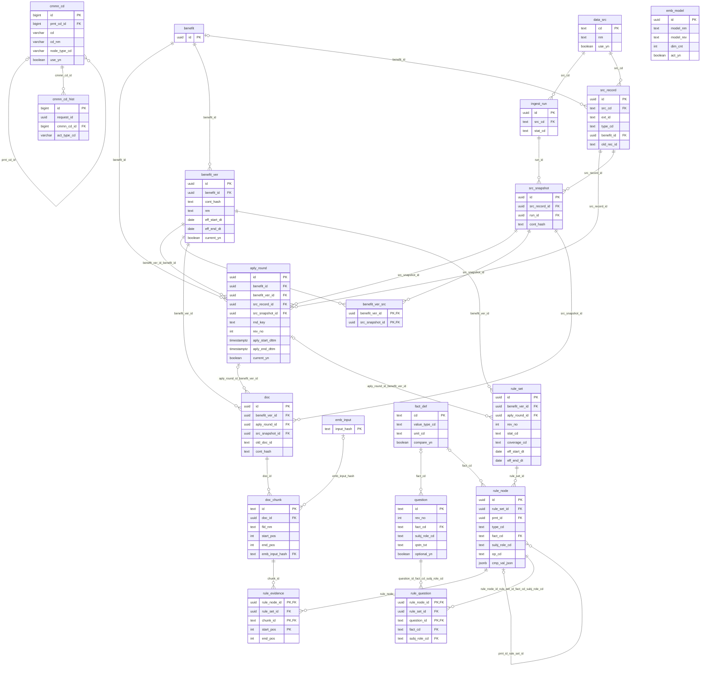
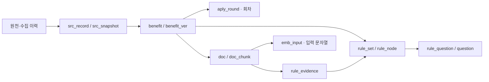
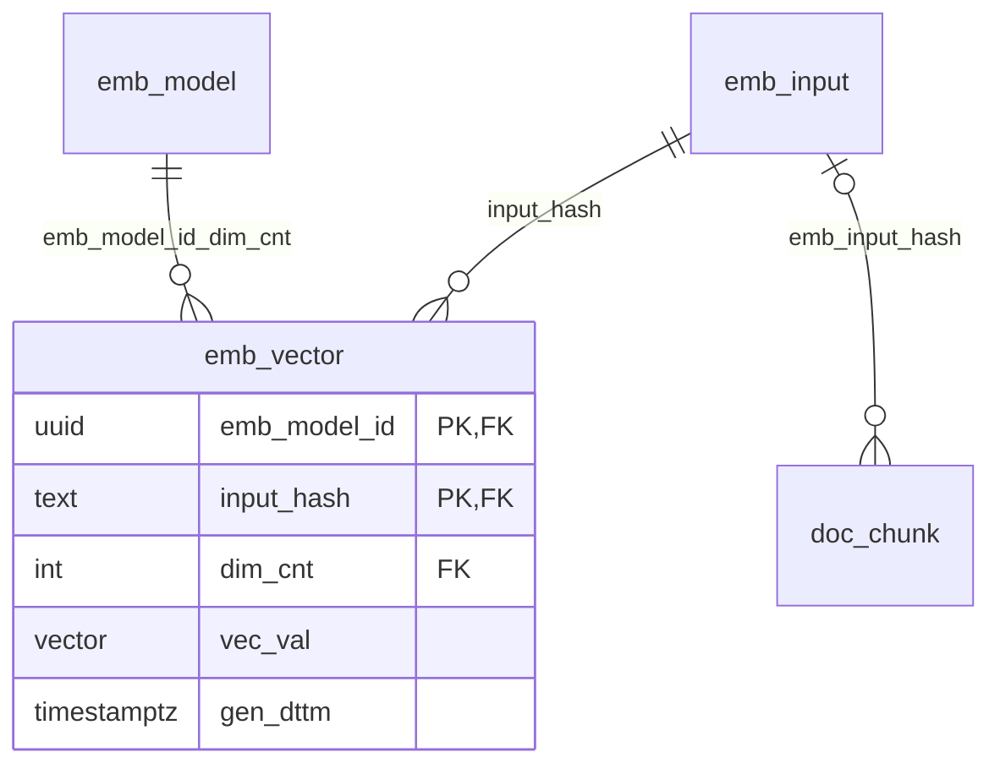

# PostgreSQL DB 구성도 · 실제 반영 기준

기준일: 2026-11-27. PostgreSQL 17.12의 실제 카탈로그에서 테이블·PK·FK를 읽어 작성했다. **현재 기본 테이블 20개**이며 아래에는 관계 키와 주요 컬럼을 표시한다. 전체 컬럼·제약은 [SQL](../database/001_core.sql)과 [관리 규칙](../database/005_aurore_lifecycle.sql)을 따른다.

## 전체 물리 ERD

공통 감사 컬럼 rgst_id/rgst_dttm/upt_id/upt_dttm/del_yn/del_dttm/del_id는 반복 표시를 생략했다. 삭제된 부모·자식은 공개 조회에서 제외한다. 복합 FK는 관계선에 컬럼 조합으로 표기했다.

## 원문에서 검색·조건으로 이어지는 흐름

- 공통코드와 이력은 cmmn_cd/cmmn_cd_hist다. 문자열 코드 검증은 트리거로 수행하므로 모든 업무 테이블에 FK 관계선을 그리지 않았다.
- 규칙 초안의 근거 연결과 실제 승인·자격 판정은 구분한다. 승인 규칙은 현재 0개다.
- aply_round는 테이블만 준비된 상태로 현재 0행이다. 원천 주거 공고를 임의의 제도에 연결하지 않았다.
- 사용자 프로필·가족 답변은 이 DB에 없다. 현재는 선택형 브라우저 암호화 보관이다.

## 모델 선택 후 적용할 벡터 확장

다음 emb_vector는 **현재 미생성**이다. 데스크탑에서 새 모델을 선택한 뒤 [002_vectors.sql](../database/002_vectors.sql)을 적용한다. emb_input은 입력 문자열이며 벡터가 아니다.

상세 명세: [DATABASE.md](DATABASE.md) · 컨벤션: [CONVENTIONS.md](CONVENTIONS.md) · 데스크탑 복원: [DESKTOP_HANDOFF.md](DESKTOP_HANDOFF.md)
